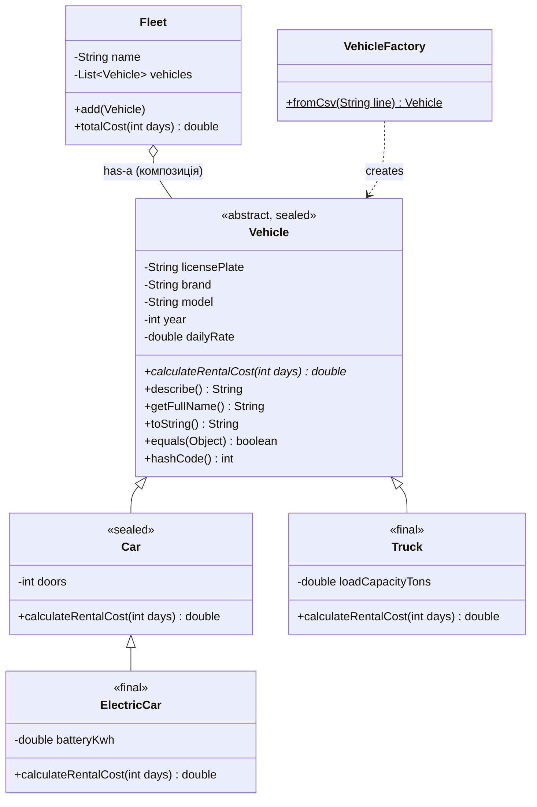

# Лабораторна робота №6. Ієрархія класів на основі наслідування

**Предметна область:** система прокату транспорту (рефакторинг класів з ЛР №1–5).
**Гілка:** `lr6/rental-hierarchy` · **Java:** 21+

## 1. Опис сутності

Раніше тип транспорту визначався рядком-полем `type` ("car" / "truck") з розгалуженням `if/switch`
у кількох місцях коду. У рефакторингу це замінено ієрархією класів: кожен тип знає, як рахувати
свою вартість оренди, а решта коду працює з `Vehicle` поліморфно.

| Клас | Рівень | Що додає |
|---|---|---|
| `Vehicle` (abstract, sealed) | 1 | номер, марка, модель, рік, добовий тариф; абстрактний `calculateRentalCost` |
| `Car` (sealed) | 2 | кількість дверей, знижка 10% від 7 днів |
| `ElectricCar` (final) | 3 | ємність батареї, доплата за зарядку |
| `Truck` (final) | 2 | вантажопідйомність, доплата за тонну |
| `VehicleFactory` | — | Simple Factory: створює об'єкт із CSV-рядка, невідомий тип -> `IllegalArgumentException` |
| `Fleet` | — | **композиція**: автопарк *має* список транспорту |

## 2. Інструкція запуску

```bash
# з кореня репозиторію (папка lr6)
mkdir -p out
javac -d out $(find src -name "*.java")          # Linux / macOS / Git Bash
java -cp out rental.Main                          # основна демонстрація
java -cp out rental.equalsdemo.EqualsSymmetryDemo # порушення симетрії equals
```

Windows PowerShell: `javac -d out (Get-ChildItem -Recurse src -Filter *.java).FullName`.
Якщо в консолі «крякозябри»: `chcp 65001` або `java -Dstdout.encoding=UTF-8 ...`.

## 3. Перевірка «is-a» (до написання коду)

- Автомобіль **є різновидом** транспортного засобу ✔
- Електромобіль **є різновидом** автомобіля ✔
- Вантажівка **є різновидом** транспортного засобу ✔
- Автопарк **є** транспортним засобом / списком? ✘ -> «має» -> композиція (розділ 6).

## 4. Рівень 1

- Спільні поля, конструктор і методи — у `Vehicle`; у підкласах лише специфічні поля (`doors`, `batteryKwh`, `loadCapacityTons`).
- Усі поля `private final`, доступ через геттери (`protected` не потрібен: підкласам вистачає геттерів і `protected static requirePositiveDays`).
- Підкласи викликають `super(...)` першим оператором.
- `@Override` для `calculateRentalCost`, `describe`, `toString`; `toString()` підкласів = `super.toString() + " | свої поля"`.
- Поліморфізм: `Main.level1Polymorphism()` — `List<Vehicle>` з `Car`, `ElectricCar`, `Truck`, у циклі викликаються `describe()` і `calculateRentalCost()`.

## 5. Рівень 2

**Абстрактний клас і метод.** `Vehicle` — abstract: «просто транспорт» в оренду не видають, екземпляр не має сенсу.
`calculateRentalCost` — абстрактний, бо формула різна (знижка / доплата за вантаж / зарядка), а розумної реалізації
за замовчуванням у базовому класі немає. Абстрактність гарантує на етапі компіляції, що жоден підклас про неї не забуде.

**Три рівні та порядок конструкторів.** `Vehicle -> Car -> ElectricCar`. При `new ElectricCar(...)` спочатку
виконується тіло `Vehicle`, потім `Car`, потім `ElectricCar` (кожен `super(...)` передає керування вгору, а тіло
виконується при поверненні):

```
[Vehicle]     конструктор виконано
[Car]         конструктор виконано
[ElectricCar] конструктор виконано
```

**`this(...)`.** Скорочені конструктори (поточний рік, 4 двері) делегують повному, тож валідація й ініціалізація
написані один раз. `this(...)` і `super(...)` в одному конструкторі разом використати не можна: обидва мають бути
першим оператором.

**`final`.**
- `Vehicle.getFullName()` — `final`: формат назви використовується у звітах, підклас не повинен його ламати.
- `ElectricCar` і `Truck` — `final`: подальше наслідування не передбачене (до того ж sealed вимагає `final/sealed/non-sealed`).

**Статичний і динамічний тип.** У `Vehicle v = new ElectricCar(...)` статичний (оголошений) тип — `Vehicle`: від нього
залежить, які методи компілятор дозволить викликати (`v.getDoors()` не скомпілюється). Динамічний (фактичний) тип —
`ElectricCar`: від нього залежить, чия версія перевизначеного методу виконається (динамічне зв'язування).
Щоб дістатись специфічного методу: `if (v instanceof ElectricCar e) { e.getBatteryKwh(); }`.
Хибне приведення `(Car) truck` дає `ClassCastException` — тому перед приведенням потрібен `instanceof`.

> Застереження: у конструкторах базових класів не викликаються перевизначувані методи — підклас ще не
> ініціалізований, і метод побачить поля зі значеннями за замовчуванням.

## 6. Рівень 3

### equals() / hashCode()
Реалізовано в `Vehicle`, `Car`, `ElectricCar`, `Truck`: підклас викликає `super.equals(o)` і порівнює свої поля;
`hashCode` включає `super.hashCode()`.

Підходи (`rental.equalsdemo.EqualsSymmetryDemo`):

| | `instanceof` | `getClass()` |
|---|---|---|
| `base.equals(sub)` | `true` | `false` |
| `sub.equals(base)` | `false` ← **симетрію порушено** | `false` |
| hashCode рівних за `base.equals` | різні — порушено контракт | n/a |
| Мінус | ламає симетрію/транзитивність при нових полях | підклас не рівний базовому (трохи суперечить LSP) |

**Вибір: `getClass()`.** Підкласи додають поля, значущі для рівності, і відновити симетрію з `instanceof`
неможливо без порушення транзитивності. Для звичайного `final`-класу `instanceof` і `getClass()` еквівалентні.

### Композиція замість наслідування — `Fleet`
Хибне `class Fleet extends ArrayList<Vehicle>`: автопарк — не «різновид списку», а сутність, яка списком *користується*.
Що зламалося б:
1. Успадковані `add(null)`, `remove`, `clear`, `set` дозволяють зіпсувати стан поза контролем класу.
2. Не вдалося б гарантувати інваріант «без дублікатів» (його забезпечує `Fleet.add`) — обхід через `addAll`/`add(index, e)`.
3. Публічний API автопарку навічно прив'язаний до `ArrayList` (не можна замінити реалізацію).
4. Порушення LSP: `Fleet` не можна підставити всюди, де очікується `List` із звичайною поведінкою.

`Fleet` тримає `private final List<Vehicle>` і віддає назовні лише `unmodifiableList`.

### Діаграма класів



### Sealed + switch з pattern matching
`Vehicle` -> `permits Car, Truck`; `Car` -> `permits ElectricCar`. Метод `Main.category(Vehicle)` використовує
`switch` **без `default`**.

**Гарантія sealed:** компілятор знає повний, скінченний перелік підтипів. Тому він перевіряє *вичерпність* `switch`:
якщо додати новий підклас у `permits` і не обробити його в `switch`, код не скомпілюється (замість прихованого
`default` і помилки в рантаймі). Також ніхто поза `permits` не зможе успадкувати клас. Порядок `case` важливий:
`ElectricCar` перед `Car`, інакше більш загальний `Car` «домінує» і компіляція завершиться помилкою.

## 7. Що довелося б змінити, щоб додати підклас (наприклад, `Motorcycle`)
Створити `Motorcycle extends Vehicle`, реалізувати `calculateRentalCost`, дописати в `permits` у `Vehicle`,
додати `case` у `switch` (компілятор підкаже де) і гілку в `VehicleFactory`. Класи `Car`, `ElectricCar`, `Truck`,
`Fleet` не змінюються.
